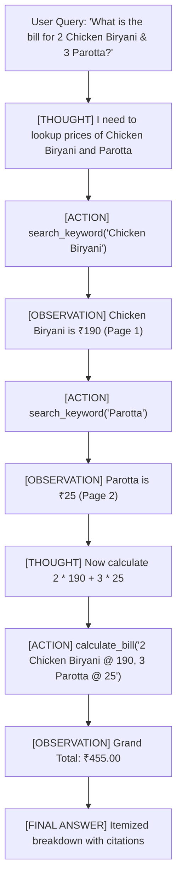

# 🤖 Agentic RAG ReAct System (Powered by Gemini)

An enterprise-grade **Agentic Retrieval-Augmented Generation (RAG)** system implementing the **ReAct (Reasoning and Action)** framework to answer questions and execute complex workflows over PDF documents (featuring **`nila.pdf`** - Nila Hotel Menu Card).

---

## 🌟 Key Features

1. **ReAct (Reasoning + Action) Paradigm**:
   - The agent thinks through questions step-by-step (`Thought`).
   - Autonomously selects and calls tools (`Action`).
   - Inspects the returned factual data (`Observation`).
   - Synthesizes grounded, cited responses (`Final Answer`).

2. **RAG Tool Suite**:
   - `search_document`: Dense semantic vector search via Gemini embeddings.
   - `search_keyword`: High-precision sparse keyword and item search.
   - `get_page_content`: Complete page-level inspection with citations.
   - `list_document_sections`: Document outline and category discovery.
   - `calculate_bill`: Precise arithmetic engine for order totals, preventing hallucinated math.

3. **Multi-Model Resilience & Fallback**:
   - Seamlessly falls back between models (`gemini-3-flash-preview`, `gemini-3.8-flash`, `gemini-flash-latest`).
   - Exponential backoff retry handling for temporary 503/429 spikes.

4. **Zero-Overhead Embedding Cache**:
   - Computes embeddings once and persists them in `.cache/index_<hash>.json`.
   - Sub-millisecond startup times on subsequent runs.

---

## 📁 Project Structure

```text
gemini_rag_react_agent/
├── .env                  # Your Gemini API Key & runtime configuration
├── .env.example          # Environment template
├── nila.pdf              # Target PDF document (Nila Hotel Menu Card)
├── main.py               # Interactive CLI, Single Query & Benchmark suite
├── test_rag_agent.py     # Automated unit & integration tests
├── requirements.txt      # Python dependencies
├── agent/
│   ├── __init__.py
│   └── react_agent.py    # ReAct autonomous agent controller
├── rag/
│   ├── __init__.py
│   ├── indexer.py        # PDF extraction, chunking, and vector caching
│   └── retriever.py      # Hybrid semantic + keyword retrieval engine
└── tools/
    ├── __init__.py
    └── rag_tools.py      # Callable tools registered with Gemini function calling
```

---

## 🚀 Quick Start Guide

### 1. Set your Gemini API Key in `.env`

Open `.env` (or copy from `.env.example`) and paste your API key from [Google AI Studio](https://aistudio.google.com/):

```env
GEMINI_API_KEY="your_actual_gemini_api_key_here"
GEMINI_MODEL="gemini-3-flash-preview"
GEMINI_EMBEDDING_MODEL="gemini-embedding-001"
DOCUMENT_PATH="nila.pdf"
```

### 2. Verify `nila.pdf`

Ensure `nila.pdf` is located in the project root directory. (The system also automatically detects `nila.pdf.pdf` or paths specified in `DOCUMENT_PATH`).

### 3. Run the Agent

#### A. Interactive Chat Session:
```bash
python main.py
```
*Ask anything interactively (e.g., "What are the breakfast options?", "How much is a Chicken Biryani?", "Calculate total for 2 Pongal and 2 Tea")*.

#### B. Single Query Execution:
```bash
python main.py "What is the price of Mutton Biryani and which section is it in?"
```

#### C. Automated Benchmark / Demo Suite:
```bash
python main.py --demo
```

### 4. Run Automated Unit Tests
```bash
python test_rag_agent.py
```

---

## 🧠 How the ReAct Loop Works


